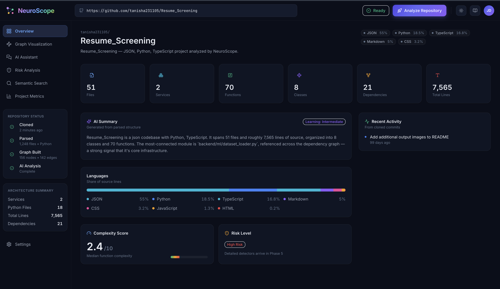
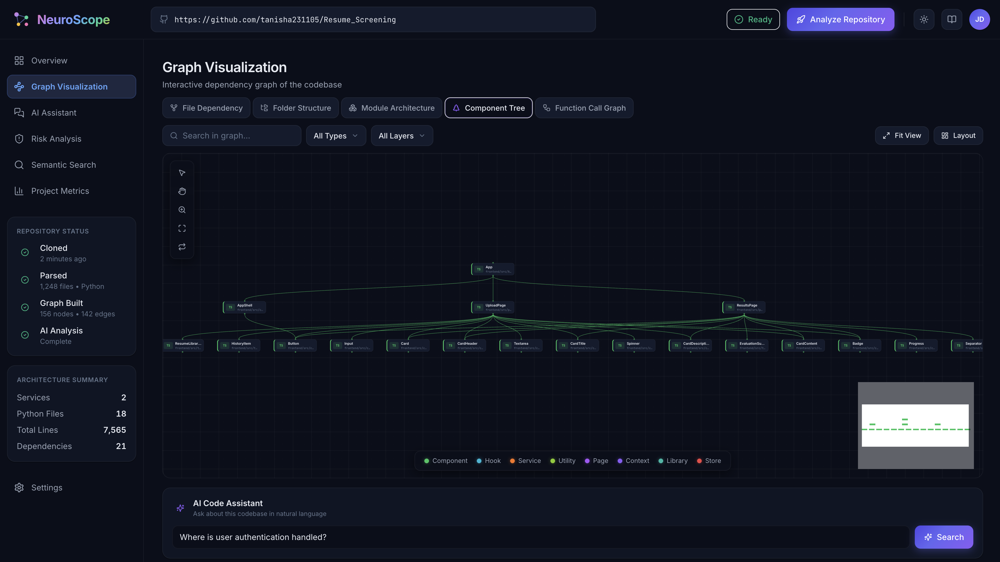
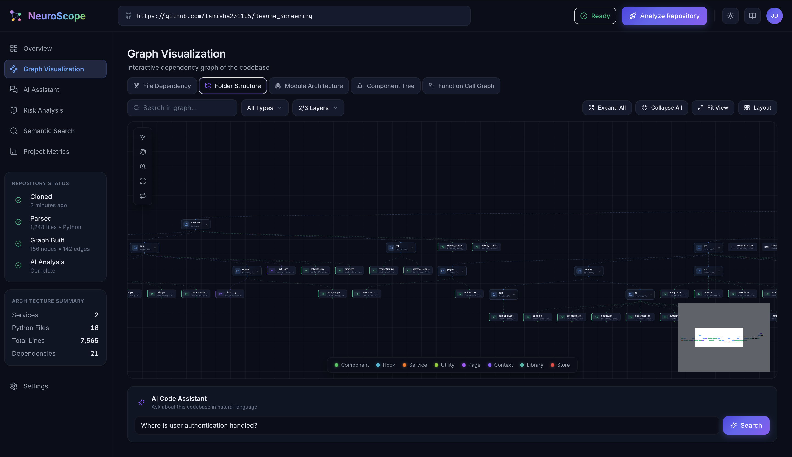
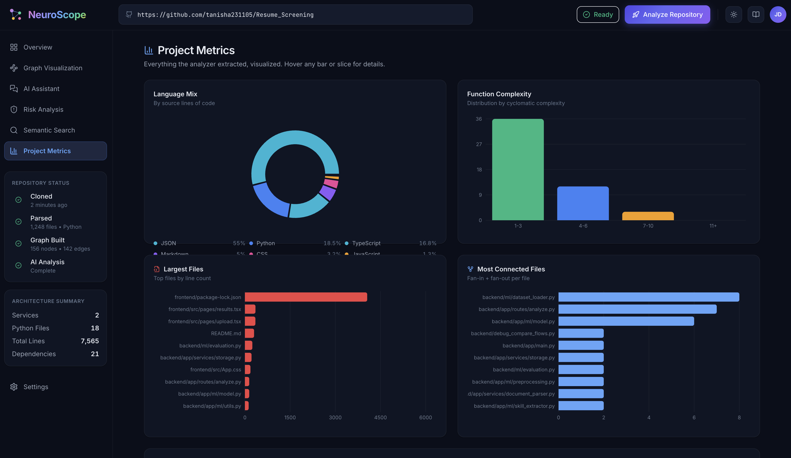
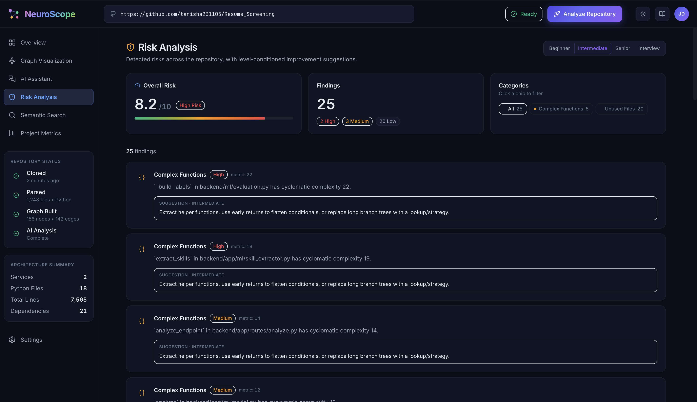
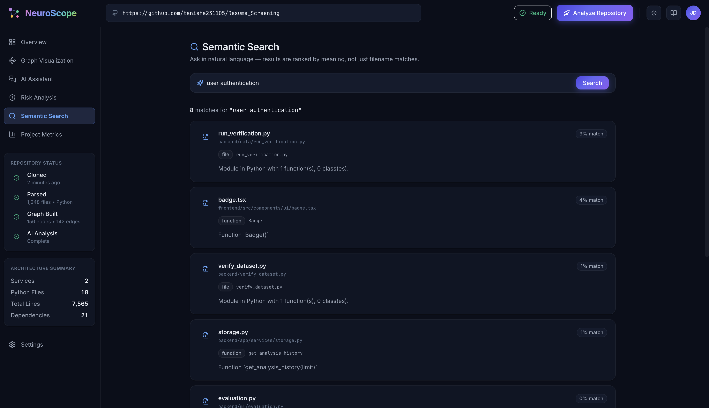

# NeuroScope

**Understand any codebase in minutes.**

NeuroScope is an AI-powered code intelligence platform. Paste a GitHub URL, and it clones the repository, parses it into an actual dependency graph, embeds every file with sentence-transformers, and lets you chat with the codebase in natural language — Beginner to Interview-prep.

Runs on your laptop. No Docker, no Kubernetes, no external services required.

<p align="center">
  
  
  
  
</p>

---

## See it in action

<p align="center">
  
</p>

<table>
  <tr>
    <td width="50%">
      
      <p align="center"><sub><b>Component Tree</b> — who renders whom, custom hooks included</sub></p>
    </td>
    <td width="50%">
      
      <p align="center"><sub><b>Folder Structure</b> — collapsible directory tree with cross-cutting imports</sub></p>
    </td>
  </tr>
  <tr>
    <td width="50%">
      
      <p align="center"><sub><b>Project Metrics</b> — language mix, complexity histogram, most-connected files</sub></p>
    </td>
    <td width="50%">
      
      <p align="center"><sub><b>Risk Analysis</b> — scored findings with beginner-to-senior suggestions</sub></p>
    </td>
  </tr>
</table>

<p align="center">
  
  <br /><sub><b>Semantic Search</b> — "user authentication" surfaces the right files by meaning, not filename</sub>
</p>

---

## What it does

- **Real dependency graph — five views, not one.** Python AST + JS/TS/JSX/TSX regex parser build actual import edges, no fake connections:
  - **File Dependency** — import graph across every source file
  - **Folder Structure** — collapsible directory hierarchy
  - **Module Architecture** — high-level view, files grouped by module
  - **Component Tree** — React/JSX composition (who renders whom) + custom-hook usage
  - **Function Call Graph** — function/method-level call graph across Python *and* JS/TS, resolved through real import bindings (including `tsconfig` path aliases like `@/*`)

  All auto-laid-out with dagre, category-colored, searchable, and clickable straight into the file detail panel.
- **Semantic search.** `sentence-transformers/all-MiniLM-L6-v2` embeddings, FAISS index per repo. Query in natural language ("where is authentication handled?") — results are ranked by meaning, not filename.
- **AI Assistant.** RAG over the FAISS index. Uses Gemini if a key is set, deterministic mock fallback otherwise. Learning Mode tabs (**Beginner / Intermediate / Senior / Interview**) change the tone of the answer.
- **Risk analysis.** Six detectors: large files, complex functions, large classes, high coupling, **real circular deps** (`nx.simple_cycles`), unused files. Each finding carries level-conditioned improvement suggestions.
- **Metrics dashboard.** Language donut, complexity histogram, largest files, most-connected files, directory distribution — all live Recharts.
- **Interactive graph.** Category-colored nodes, hover + click focus mode with edge highlighting, search + category filters, minimap, weighted edges in module view.

---

## Quick start

### 1. Backend

```bash
cd backend
python3 -m venv venv
source venv/bin/activate           # Windows: venv\Scripts\activate
pip install -r requirements.txt
uvicorn main:app --port 8000
```

The first analysis you run downloads the sentence-transformers model (~90 MB) — subsequent analyses use the cached weights. Backend health: `curl http://localhost:8000/health`.

### 2. Frontend

```bash
cd frontend
npm install
npm run dev
```

Open **http://localhost:5173**.

### 3. Optional — enable real Gemini

Create `backend/.env`:

```
GEMINI_API_KEY=your_google_ai_studio_key
```

Without a key, NeuroScope uses a deterministic template-based fallback so every feature still works end-to-end — the semantic retrieval still runs, and the "answer" is composed from real citations.

---

## Tech stack

**Frontend** — React 18 · Vite 6 · TailwindCSS 3 · shadcn-style primitives · React Flow · dagre · Framer Motion · Recharts · React Router · Lucide React · Axios

**Backend** — Python 3.9+ · FastAPI · GitPython · Python `ast` · regex JS/TS parser · NetworkX · FAISS (CPU) · sentence-transformers · google-generativeai (optional) · SQLite (single-table blob store)

---

## Project layout

```
NUEROSCOPE/
├── backend/
│   ├── api/             FastAPI routers  (health, analyze, repos, chat)
│   ├── analyzer/        pipeline, jobs registry, risk detectors, mock AI, metrics
│   ├── parser/          GitPython clone, Python AST parser, JS/TS regex parser, module resolver
│   ├── graph/           file / folder / module / component-tree / call-graph builders
│   ├── search/          embeddings loader, chunker, FAISS index
│   ├── ai/              Gemini client, prompts, RAG chat
│   ├── models/          SQLite blob store, Pydantic schemas
│   ├── utils/           hashing, paths
│   ├── repos/           cloned repos (gitignored)
│   ├── cache/           SQLite db + FAISS indexes (gitignored)
│   ├── main.py          FastAPI entrypoint
│   └── requirements.txt
│
├── frontend/
│   ├── src/
│   │   ├── components/
│   │   │   ├── ui/         Button, Card, Input, Badge, StatusPill, IconButton, ErrorBoundary
│   │   │   ├── layout/     TopNav, Sidebar, BrandLogo
│   │   │   ├── graph/      CategoryNode, FolderNode, ModuleGroupNode, Legend, Toolbar, ModeSwitcher, SearchBar, AIAssistant
│   │   │   ├── panels/     NodeDetailPanel
│   │   │   ├── charts/     LanguageDonut, ComplexityHistogram, HorizontalBar, ChartCard
│   │   │   ├── chat/       ChatMessage, CitationChip, LevelSwitcher
│   │   │   ├── widgets/    MetricStat, StatusRail, ArchitectureSummary
│   │   │   └── loading/    Skeleton, PhasePlaceholder
│   │   ├── pages/          Overview, GraphVisualization, AIAssistant, SemanticSearch,
│   │   │                   RiskAnalysis, ProjectMetrics, Settings, NotFound
│   │   ├── layouts/AppLayout.jsx
│   │   ├── hooks/          useRepo, useJob, useOverview, useGraph, useSearch, useChat,
│   │   │                   useRisks, useMetrics, useToast, useTheme
│   │   ├── services/       api.js, analysisApi.js, searchApi.js
│   │   ├── utils/          nodeCategories, graphLayout, formatters, mockData
│   │   ├── styles/         tokens.css, globals.css
│   │   └── lib/            cn.js
│   ├── index.html, vite.config.js, tailwind.config.js, package.json
│
└── docs/superpowers/specs/    design brief
```

---

## API surface

| Method | Path                                       | Purpose                                        |
|--------|--------------------------------------------|------------------------------------------------|
| GET    | `/health`                                  | liveness + AI provider indicator               |
| POST   | `/analyze`                                 | start analysis: `{repo_url}` → `{repo_id, job_id}` |
| GET    | `/analyze/{job_id}/status`                 | poll progress per stage                        |
| GET    | `/repos`                                   | list analyzed repos                            |
| GET    | `/repos/{repo_id}`                         | overview card data                             |
| GET    | `/repos/{repo_id}/graph?mode=file\|folder\|module\|tree\|callgraph` | React-Flow-ready `{nodes, edges}` |
| GET    | `/repos/{repo_id}/metrics`                 | chart datasets                                 |
| GET    | `/repos/{repo_id}/risks`                   | findings + score + counts                      |
| GET    | `/repos/{repo_id}/files/{file_id}?level=…` | file detail + level-conditioned explanation    |
| POST   | `/repos/{repo_id}/search`                  | semantic search: `{query, top_k}` → hits       |
| POST   | `/repos/{repo_id}/chat`                    | RAG chat: `{query, level}` → answer + citations |
| GET    | `/repos/{repo_id}/ai/status`               | is Gemini configured? is FAISS index ready?    |

---

## How the analysis pipeline works

```
GitHub URL
   │
   ▼ 1. clone   (GitPython, shallow, single-branch)
backend/repos/{repo_id}/
   │
   ▼ 2. parse   (per-file dispatch)
      ┌─ .py   → Python `ast` module → classes / functions / imports / cyclomatic complexity
      └─ .js/.jsx/.ts/.tsx/.mjs/.cjs → regex parser → imports / defs / branch-count complexity
   │
   ▼ 3. graph   (import resolver, per-language)
      ├─ Python: dotted-name → file, with stdlib skiplist + relative-import support
      └─ JS/TS: relative paths, ext guessing (.js/.jsx/.ts/.tsx/.mjs/.cjs), /index.<ext> for folder imports
      → NetworkX-friendly {source, target} edges, deduplicated
   │
   ▼ 4. ai       (embeddings + summary)
      ├─ chunks: one per file + one per class + one per function (with docstrings)
      ├─ embed: sentence-transformers/all-MiniLM-L6-v2, L2-normalized, FAISS IndexFlatIP
      └─ summary: Gemini if configured, deterministic mock otherwise
   │
   ▼ persist    (SQLite blob per repo + FAISS index on disk)
```

Any missing Gemini key at any of these steps degrades gracefully — no exceptions, no crashes. The mock reply cites real semantic-search hits so the UX still feels intelligent.

**Component Tree & Function Call Graph** are computed on-demand, straight from the cloned source on disk, rather than being baked into the persisted blob above — the underlying regex/AST extraction is cheap enough to redo per request, and it means both views work immediately even on repos analyzed before these existed. `graph/component_tree.py` slices out approximate function/class bodies to scan for JSX tags and hook calls; `graph/call_graph.py` walks Python's `ast.Call` nodes and mirrors the same body-slicing approach for JS/TS, then resolves every call/render target through real import bindings (`from x import y`, default/namespace imports, and `tsconfig.json` `paths` aliases).

---

## Design system

Tokens live in `frontend/src/styles/tokens.css` and are consumed via the Tailwind theme extension — nothing is hardcoded in components.

- **Surface** — `bg-base` `bg-panel` `bg-elevated` `bg-hover` `bg-active`
- **Ink** — `text-primary` `text-secondary` `text-muted`
- **Accent** — `blue` `cyan` `emerald` `amber` `red` `purple` `pink`
- **Node categories** — `frontend` `api` `db` `cache` `service` `utility` (visual buckets)
- **Radius** — `sm 6` `md 10` `lg 14` `xl 20`
- **Motion** — `120 / 200 / 320 ms` on `cubic-bezier(0.16, 1, 0.3, 1)`

Light theme flips the token values via `[data-theme='light']` — the theme toggle in the top nav writes to `localStorage` and updates the `<html data-theme>` attribute.

---

## Troubleshooting

- **First analysis feels slow.** First run downloads `sentence-transformers/all-MiniLM-L6-v2` (~90 MB). Subsequent runs use the cached model — full analysis of a ~130-file repo drops to under a minute.
- **JS parser missed an import.** The regex parser catches the ~95% cases (ES6 `import ... from`, `require`, dynamic `import()`, `export ... from`). Bare-package imports (`react`, `lodash`) are intentionally skipped. If you need a full AST, `@babel/parser` is a drop-in in a small Node subprocess.
- **Backend keeps restarting mid-analysis.** Uvicorn's `--reload` watches `repos/` too, and clones write `.py` files there. `main.py` is now started without `--reload` in the Quick Start — restart manually with `pkill -f uvicorn && (cd backend && source venv/bin/activate && uvicorn main:app --port 8000 &)` after backend edits.
- **`Unknown job_id`** on the analyze status endpoint. The job registry is in-memory and cleared on backend restart. Kick off a fresh analysis.
- **SQLite locked errors.** Only one analysis should be running at a time; kick off the next one after the first completes.

---

## Roadmap ideas

- Full AST parsing for JS/TS via `@babel/parser` subprocess (would sharpen Component Tree / Call Graph edge cases the regex slicer misses — generics, decorators, nested destructuring)
- Persist Component Tree / Call Graph extraction into the analysis blob instead of recomputing per request, once the shape stabilizes
- Multi-turn chat with conversation history sent to Gemini
- Command palette (`⌘K`) for global fuzzy navigation
- WebSocket-based progress streaming instead of polling
- Bundled sample repositories for zero-network demos

---

